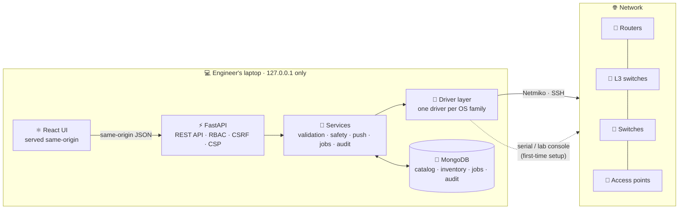
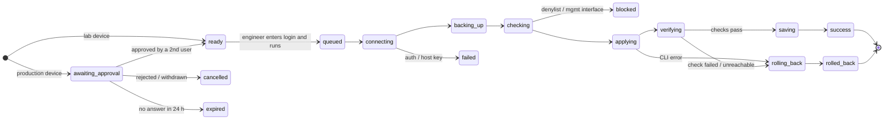
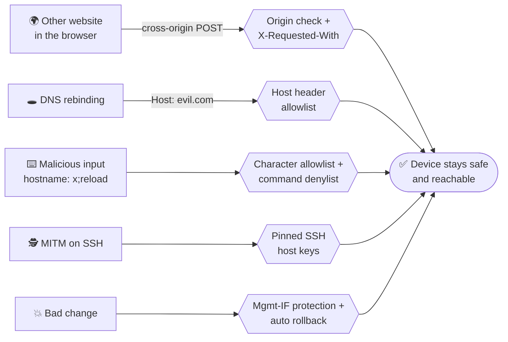

<a id="top"></a>
<div align="center">



<br/>

**Configure switches, Layer 3 switches, routers and access points from one form instead of one CLI command at a time.<br/>
NetConfig Studio validates your plan, generates the correct commands for each vendor's OS, and pushes them with backup, verification and automatic rollback.**

<br/>


<br/>


<br/>

[**Why**](#-why-netconfig-studio) ·
[**Demo**](#-see-it-work) ·
[**Features**](#-features) ·
[**Architecture**](#-architecture) ·
[**Push pipeline**](#-the-safe-push-pipeline) ·
[**Vendors**](#-supported-platforms) ·
[**Quick start**](#-quick-start) ·
[**Security**](#-security-by-design) ·
[**Docs**](#-documentation)

</div>

---

## 🌐 Why NetConfig Studio

Network engineers still configure most devices **one command at a time in PuTTY**. Every vendor speaks a
different CLI dialect, one typo can take a site offline, the first SSH setup needs a console cable, and
nobody keeps a record of what changed.

<table>
<tr>
<th width="50%">❌ The usual way</th>
<th width="50%">✅ With NetConfig Studio</th>
</tr>
<tr>
<td>

- Look up the syntax for Cisco, then Junos, then AOS-CX…
- Paste commands line by line into a terminal
- Find a mistake only after the port goes down
- Lose the management session by shutting the wrong interface
- No backup, no rollback, no record of who changed what

</td>
<td>

- Pick **category → brand → series → model** and fill in a form
- Plan is **validated** (subnets, VLANs, port names, AS numbers)
- **Preview** the exact commands for that device's OS
- **Backup → apply → verify → confirm**, or roll back automatically
- Every action goes to an **append-only, hash-chained audit log**

</td>
</tr>
</table>

> [!IMPORTANT]
> NetConfig Studio runs **on the engineer's own laptop, inside the network**, bound to `127.0.0.1`.
> It is not a cloud app, because it has to reach the devices it configures.

---

## 🎬 See it work

<div align="center">

<br/><sub>A VLAN + access-port plan for a Cisco IOSvL2 switch. The commands shown come from the driver's real golden test files.</sub>
</div>

---

## ✨ Features

<table>
<tr>
<td width="33%" valign="top">

### 🧭 Guided configuration
5-step **Configure wizard**: VLANs, access and trunk ports, SVIs, routed interfaces, DHCP pools, NAT,
static routes, **OSPF / EIGRP / BGP**, SSH and hardening. Templates save a form for reuse (never with passwords).

</td>
<td width="33%" valign="top">

### 🔌 Multi-vendor drivers
One driver per **OS family**, not per model. Each one is a pure generator with **golden-file tests**,
and an unsupported feature gives a clear *"not supported on &lt;OS&gt;"* error instead of being skipped silently.

</td>
<td width="33%" valign="top">

### 🛡️ Safe push engine
Backup, management-interface protection, a command **denylist**, stop at the first CLI error,
`show`-command verification, and rollback with the vendor's native mechanism.

</td>
</tr>
<tr>
<td valign="top">

### 🗺️ Live overview & topology
Status polling (TCP/SSH or ping), read-only discovery of model, version, serial, **LLDP/CDP neighbours**
and VLANs, a keyboard-navigable network map, and 14-day charts.

</td>
<td valign="top">

### 🔗 Multi-device wizards
Push the **same change to 2–20 switches**, build a matching **router-to-router link** (/30 or /31 + OSPF/EIGRP/eBGP
on both sides), or do **first-time setup** over a serial or lab console.

</td>
<td valign="top">

### 👥 Two-person approval
Devices tagged `production` need a **different admin** to approve within 24 h. Commands are frozen with a
**SHA-256 hash**, and the job only runs if the regenerated commands still match it.

</td>
</tr>
<tr>
<td valign="top">

### 🔐 Credentials never stored
Device logins are typed **at push time**, held in memory as `SecretStr` for that job only, then wiped.
Secrets in commands, output and backups are **masked**.

</td>
<td valign="top">

### 🤖 Optional AI assistant
Turn a sentence into a draft plan, or **explain** commands, a failed push or a config diff.
Works with Ollama (local), Groq or Gemini. The AI never pushes anything itself.

</td>
<td valign="top">

### 🎨 Polished, accessible UI
"Liquid glass" light and dark themes, WCAG 2.1 AA contrast, full keyboard support, 44 px touch targets,
and usable down to a **375 px** phone screen.

</td>
</tr>
</table>

---

## 🏗️ Architecture



<details>
<summary><b>🔍 Why this design? (click to expand)</b></summary>
<br/>

| Decision | Reason | ADR |
|---|---|---|
| Runs locally, bound to `127.0.0.1` | It must reach the devices; a localhost app cannot be reached by others on the network | [0001](docs/adr/0001-local-app-bound-to-localhost.md) |
| One driver per **OS family** | Commands depend on the OS, not the model; models are just catalog data | [0002](docs/adr/0002-os-driver-plugin-design.md) |
| Netmiko instead of automating PuTTY | Same SSH / Telnet / serial access, but scriptable, testable and checkable for errors | [0003](docs/adr/0003-netmiko-instead-of-putty.md) |
| Device credentials in memory only | A stolen database or log file contains no device passwords | [0004](docs/adr/0004-device-credentials-in-memory-only.md) |

Every driver implements the same interface:

```python
class Driver(Protocol):
    os_id: str
    netmiko_device_type: str
    capabilities: set[str]
    def generate(self, plan, kind) -> list[str]: ...          # config commands (pure function)
    def verify_commands(self, plan) -> list[str]: ...         # show commands
    def check(self, plan, outputs) -> list[Check]: ...        # did it really work?
    def error_patterns(self) -> list[str]: ...                # "% Invalid input", "syntax error" …
    def save_command(self) -> str | None: ...
    def rollback_strategy(self) -> str: ...                   # revert_timer | commit_confirmed | backup_restore
    def management_interface(self, outputs, mgmt_ip) -> str | None: ...
```

Full write-up: [docs/SYSTEM_DESIGN.md](docs/SYSTEM_DESIGN.md) · interactive diagrams in [docs/diagrams/](docs/diagrams/).
</details>

---

## 🚦 The safe push pipeline

<div align="center">

</div>

1. **Create job** (Configure step 4): the exact commands are frozen with a SHA-256 hash. No credentials yet.
2. **Approval** (only devices tagged `production`): a *different* admin approves in History within 24 hours.
3. **Run:** the device login is typed now, sent once, kept in memory for this job only and wiped when it ends.
   The commands are regenerated and must match the approved hash.
4. **Push engine:** connect (SSH host key checked) → back up `show running-config` → find the interface that
   holds the management IP → denylist and management checks → apply inside `configure terminal revert timer N`
   → stop at the first CLI error → verify with `show` commands → `configure confirm` → `write memory`.
   Any error after applying → `configure revert now`. If the device becomes unreachable, its own timer restores the old config.
5. **History** shows the timeline, checks, the masked transcript and the masked backup.

<details>
<summary><b>📊 Job life cycle – every state a job can be in (click to expand)</b></summary>
<br/>


</details>

<details>
<summary><b>⛔ What the denylist catches (click to expand)</b></summary>
<br/>

Matching is on **whole commands**, so `no shutdown` and `description reload-test` are allowed, but all of these are blocked:

| Blocked | Also caught |
|---|---|
| `reload`, `erase`, `write erase`, `delete`, `format` | Cisco abbreviations: `rel` = `reload` |
| `no username`, `crypto key zeroize` | A `do` prefix: `do reload` |
| `request system zeroize`, `request system reboot` | Any letter case and extra spaces |
| `debug all` | Several commands on one line |
| `shutdown` / `no ip address` / VLAN move **on the management interface** | Removing SSH from the VTY lines while connected over SSH |

</details>

---

## 🧩 Supported platforms

| Vendor | OS driver (`os_id`) | Device types | Rollback strategy | Status |
|---|---|---|---|---|
| **Cisco** | `cisco_ios` | Switch · L3 switch · Router | `archive` + `configure terminal revert timer` | 🟡 experimental |
| **Arista** | `arista_eos` | L3 switch | `configure session` + `commit timer` | 🟡 experimental |
| **Juniper** | `juniper_junos` | Switch · L3 switch · Router | `commit confirmed N` | 🟡 experimental |
| **Aruba (HPE)** | `aruba_aoscx` | Switch · L3 switch | `checkpoint auto N` | 🟡 experimental |
| MikroTik | `mikrotik_routeros` | Router · Switch | Restore from backup | 🧪 opt-in |
| Huawei | `huawei_vrp` | Switch | Restore from backup | 🧪 opt-in |
| D-Link | `dlink_ds` | Switch | Restore from backup | 🧪 opt-in |
| TP-Link | `tplink_jetstream` | Switch | Restore from backup | 🧪 opt-in |
| Access points · cameras | `ap_controller` · `camera_onvif` | AP · Camera | – | 📋 inventory + status only |

> [!NOTE]
> A driver is marked **tested** only after it has been proven on an emulator (GNS3 / Cisco CML-Free,
> vJunos, cEOS-lab, AOS-CX Simulator, MikroTik CHR) following [docs/LAB_TESTING.md](docs/LAB_TESTING.md).
> Until then, `production` pushes need `ENABLE_EXPERIMENTAL_DRIVERS=true`. 🧪 drivers are disabled unless that
> flag is set, and are labelled in the UI. Per-driver notes: [docs/drivers/](docs/drivers/).

---

## 🚀 Quick start

**Requirements (all free, Windows 11):** Python 3.12 (3.10 works for now), Node.js 20+,
MongoDB Community Server on `127.0.0.1:27017`, Git.

```powershell
git clone https://github.com/munisaidivith19-sketch/NETCONFIG.git
cd NETCONFIG
python run.py --demo        # simulated device: try everything without a lab
```

`run.py` uses only the standard library. It creates `backend\.venv`, installs the pinned packages, creates
`backend\.env`, checks the settings and MongoDB, offers to create the first admin, builds the frontend, starts the
app and opens the browser. Every step prints **OK** or **FAIL**, and a failure tells you how to fix it.

| Command | What it does |
|---|---|
| `python run.py` | Production mode on http://127.0.0.1:8000 |
| `python run.py --demo` | Simulated Cisco switch instead of the real network |
| `python run.py --dev` | Backend auto-reload + Vite dev server on `:5173` |
| `python run.py --test` | Backend and frontend test suites |

<details>
<summary><b>🛠️ Manual setup, step by step</b></summary>
<br/>

```powershell
# 1. Backend: creates backend\.venv, installs pinned packages, creates backend\.env, starts the API
powershell -ExecutionPolicy Bypass -File scripts\dev-backend.ps1
# (stop it with Ctrl+C after it starts once)

# 2. Create the first admin (the password is typed, never shown)
cd backend
.venv\Scripts\python scripts\create_user.py admin --role admin

# 3. Frontend
cd ..\frontend
npm ci
```
The sample catalog is loaded automatically on first start (or run `scripts\seed_catalog.py`).

**Development (two terminals):**
```powershell
powershell -ExecutionPolicy Bypass -File scripts\dev-backend.ps1   # API on http://127.0.0.1:8000
cd frontend; npm run dev                                          # UI  on http://127.0.0.1:5173
```
Vite forwards `/api` to the backend, so the browser sees one origin.

**Daily use (one process):**
```powershell
powershell -ExecutionPolicy Bypass -File scripts\start.ps1        # -NoBrowser to skip opening the browser
```
It checks MongoDB, rebuilds the frontend if a source file changed, starts the app with `ENV=production`
(API docs off, simulation refused) and opens http://127.0.0.1:8000.
</details>

<details>
<summary><b>🧪 Try a push without a device (simulation mode)</b></summary>
<br/>

For demos and UI work only. Pushes go to an in-memory pretend Cisco switch, and a yellow banner says so on
every page. Simulation is refused when `ENV=production`.

```powershell
cd backend
$env:SIMULATE_DEVICES="true"; .venv\Scripts\python -m app
```
Add a device (for example model *Cisco IOSvL2*, management IP `10.0.0.2`), then
**Configure → Preview → Create job → enter any username and password → Run**.
The password `wrong` simulates a login failure.

**Public online demo** (Render + MongoDB Atlas, simulated devices only, `DEMO_MODE=true`):
see [docs/DEPLOY_RENDER.md](docs/DEPLOY_RENDER.md). The real tool is never deployed to the cloud, because it must
sit inside the network it configures.
</details>

<details>
<summary><b>🤖 Turning on the AI assistant</b></summary>
<br/>

Off by default. Set `AI_PROVIDER` in `backend\.env` to `ollama` (runs on this PC, free, no key), `groq` or
`gemini` (free tiers, need `AI_API_KEY`), then restart.

- **Describe what you need** (Configure → Requirements): a sentence becomes a draft plan that fills the form.
  The draft is validated, previewed, safety-checked and approved like any other plan. It never includes SSH logins
  or custom commands.
- **Explain** buttons: preview and job commands, a failed push, and "Compare with the previous backup".
- Text is masked before it is sent, and device output is treated as untrusted (prompt-injection defence).
  Engineers only, 10 requests per minute. Details: [docs/AI_ASSISTANT.md](docs/AI_ASSISTANT.md).
</details>

---

## 🔒 Security by design

This is a **network security project first**. Every layer assumes something around it might be hostile.



| Layer | Control |
|---|---|
| **Network exposure** | Binds to `127.0.0.1`. Any other address needs `ALLOW_REMOTE=true` **and** an HTTPS certificate, or the app refuses to start |
| **Browser attacks** | Host allowlist (DNS rebinding), Origin check + `X-Requested-With: NetConfigStudio` (CSRF to localhost), no CORS, strict CSP, `X-Frame-Options: DENY`, `Referrer-Policy: no-referrer` |
| **Identity** | bcrypt cost 12, 12+ character passwords, lockout after 5 failures for 15 min, server-side sessions (8 h absolute / 30 min idle) in `httpOnly` + `SameSite=Strict` cookies |
| **Authorization** | Roles `admin` / `engineer` / `viewer`, checked on the server for every route. **Deny by default:** the app refuses to start if any route has no role check |
| **Input** | Pydantic `extra="forbid"`, strict types (`"10"` is not a number), size limits, `ipaddress` validation, and allowlisted characters (no newline, `;`, `|`, `#`, `^`, `?`) so text fields can't inject CLI commands |
| **Device access** | Passwords in memory only, SSH host keys pinned (TOFU, admin re-accepts on change), Telnet only for lab consoles on loopback / RFC 1918 |
| **Change safety** | Denylist, management-interface protection, two-person rule for `production`, frozen command hash, automatic rollback |
| **Accountability** | Append-only audit log with a **hash chain**, so edits or deletions can be detected. Secrets are masked everywhere |
| **Supply chain** | Pinned versions; `pip-audit`, `npm audit`, `bandit` and `ruff` before each release |

<sub>Deep dive: [docs/SECURITY.md](docs/SECURITY.md) (STRIDE threat model and compliance table) ·
[docs/SECURITY_TESTING.md](docs/SECURITY_TESTING.md) (how to demo each control) ·
[docs/ACCEPTED_RISKS.md](docs/ACCEPTED_RISKS.md)</sub>

---

## 🧰 Tech stack

<table>
<tr><td><b>Backend</b></td><td>Python 3.12 (3.10 compatible) · FastAPI · Pydantic v2 · Uvicorn · Netmiko · Paramiko · pyserial · PyMongo · bcrypt</td></tr>
<tr><td><b>Frontend</b></td><td>React 19 · Vite · React Router · plain CSS with design tokens · lucide-react · Inter & JetBrains Mono</td></tr>
<tr><td><b>Database</b></td><td>MongoDB Community Server (local) – catalog, inventory, jobs, backups, audit log</td></tr>
<tr><td><b>Quality</b></td><td>pytest · Vitest + Testing Library · ruff · bandit · pip-audit · npm audit</td></tr>
<tr><td><b>Lab</b></td><td>GNS3 · Cisco CML-Free (IOSv, IOSvL2) · Juniper vJunos · Arista cEOS-lab · Aruba AOS-CX Simulator · MikroTik CHR</td></tr>
</table>

---

## ✅ Testing

```powershell
cd backend;  .venv\Scripts\python -m pytest     # needs MongoDB (uses database netconfig_test, dropped after)
cd frontend; npm test; npm run build
powershell -ExecutionPolicy Bypass -File scripts\check.ps1   # everything at once (-Quick skips online audits)
```

| Suite | What it proves |
|---|---|
| **Golden files** | Each driver × feature produces exactly the expected commands (`tests/golden/<os_id>/*.txt`) |
| **Push engine** | With a fake Netmiko connection: success, CLI error mid-way, unreachable → rollback, denylist, management interface, masking |
| **Security** | Wrong Host header, cross-origin POST, missing custom header, unauthenticated / viewer access, lockout, oversize input |
| **Database** | Real local MongoDB in a separate test database. A phase is not done while these are skipped |
| **Frontend** | Vitest + Testing Library for every page and wizard, plus a production build |

<sub>Rewrite golden files after an intended change: `UPDATE_GOLDEN=1 .venv\Scripts\python -m pytest tests/drivers`, then review the diff.</sub>

---

## 📁 Project layout

```text
NETCONFIG/
├── run.py                    one-command launcher (setup, checks, start, tests)
├── backend/
│   ├── app/
│   │   ├── api/              routers: auth, catalog, devices, plans, jobs, audit, overview …
│   │   ├── drivers/          cisco_ios · arista_eos · juniper_junos · aruba_aoscx · experimental/
│   │   ├── services/         validation · safety · push · jobs · audit
│   │   ├── security/         localhost guard · sessions · CSRF · RBAC · rate limit · masking
│   │   └── data/catalog.json brands → series → models → OS drivers
│   ├── tests/                unit, security, push-engine and golden-file tests
│   └── scripts/              create_user · seed_catalog · NetBox device-type import
├── frontend/src/             pages · components · lib · styles/tokens.css (design system)
├── docs/                     design, ADRs, security, drivers, lab testing, user guide
└── scripts/                  dev-backend.ps1 · start.ps1 · check.ps1
```

---

## 🗺️ Roadmap

<details>
<summary><b>Build progress, phase by phase (click to expand)</b></summary>
<br/>

| Phase | Part | Status |
|---|---|---|
| 1 | 1A architecture, ADRs, diagrams, test plan | ✅ done |
| 1 | 1B backend skeleton, security foundation, login UI | ✅ done |
| 1 | 1C catalog and device inventory | ✅ done |
| 1 | 1D review | ✅ done |
| 2 | 2A Cisco IOS research, 2B plan validation, Cisco driver, preview API, Configure wizard | ✅ done |
| 2 | 2C review | ✅ done |
| 3 | 3A safe push engine, approvals, live progress, History, SSH host keys | ✅ done |
| 3 | 3B console bootstrap, router link wizard, multi-device, templates | ✅ done (lab checklist not run yet) |
| 3 | 3C review (code review, simplify, security review) | ✅ done |
| 4 | 4A Arista, Juniper, Aruba drivers; experimental MikroTik, Huawei, D-Link, TP-Link; APs and cameras | ✅ done (experimental until lab tests pass) |
| 4 | 4B status polling, read-only discovery, topology, live Overview | ✅ done |
| 4 | 4C UI quality pass (contrast, keyboard, phone width, copy) | ✅ done |
| 4 | 4D review | ✅ done |
| 5 | 5A AI assistant (Ollama / Groq / Gemini; draft + explain) | ✅ done (not yet tried with a live provider) |
| 5 | 5B security hardening (§8 review, HTTPS for remote mode, strict types, STRIDE) | ✅ done |
| 5 | 5C clean-up, docs and release | ✅ done |

</details>

**Next up**
- [ ] Run the emulator lab checklist and promote drivers from *experimental* to **tested**
- [ ] SNMPv3 polling (needs the `pysnmp` library, waiting for approval)
- [ ] Try the AI assistant against live providers

---

## 📚 Documentation

| Guide | For |
|---|---|
| [User guide](docs/USER_GUIDE.md) | Using every page, step by step |
| [System design](docs/SYSTEM_DESIGN.md) · [ADRs](docs/adr/) | How and why it is built this way |
| [Drivers](docs/DRIVERS.md) · [per-vendor notes](docs/drivers/) | Adding or reviewing an OS driver |
| [Security](docs/SECURITY.md) · [Security testing](docs/SECURITY_TESTING.md) | Threat model and how to demo each control |
| [Lab testing](docs/LAB_TESTING.md) | Proving a driver on GNS3 / CML / vJunos / cEOS |
| [Test plan](docs/TEST_PLAN.md) · [UI review](docs/UI_REVIEW.md) | What is tested and how the UI was checked |
| [Deploy demo on Render](docs/DEPLOY_RENDER.md) | Public demo with simulated devices only |
| [Release checklist](docs/RELEASE_CHECKLIST.md) · [Tech debt](docs/TECH_DEBT.md) · [Accepted risks](docs/ACCEPTED_RISKS.md) | Maintainers |

---

<div align="center">

**NetConfig Studio**: *plan → validate → preview → push → verify → audit.*

<sub>Built phase by phase as a network-security engineering project. Free tools only, runs natively on Windows 11, no Docker.</sub>

<br/><br/>

<a href="#top"></a>

</div>
